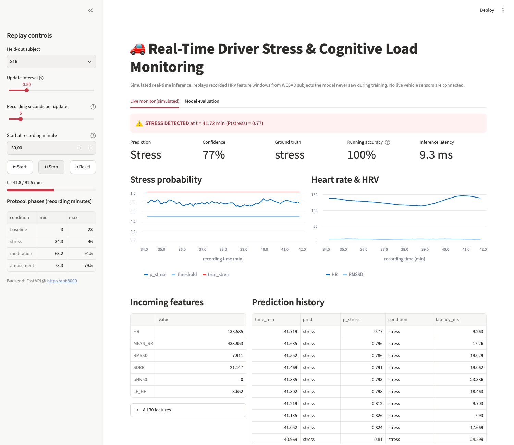
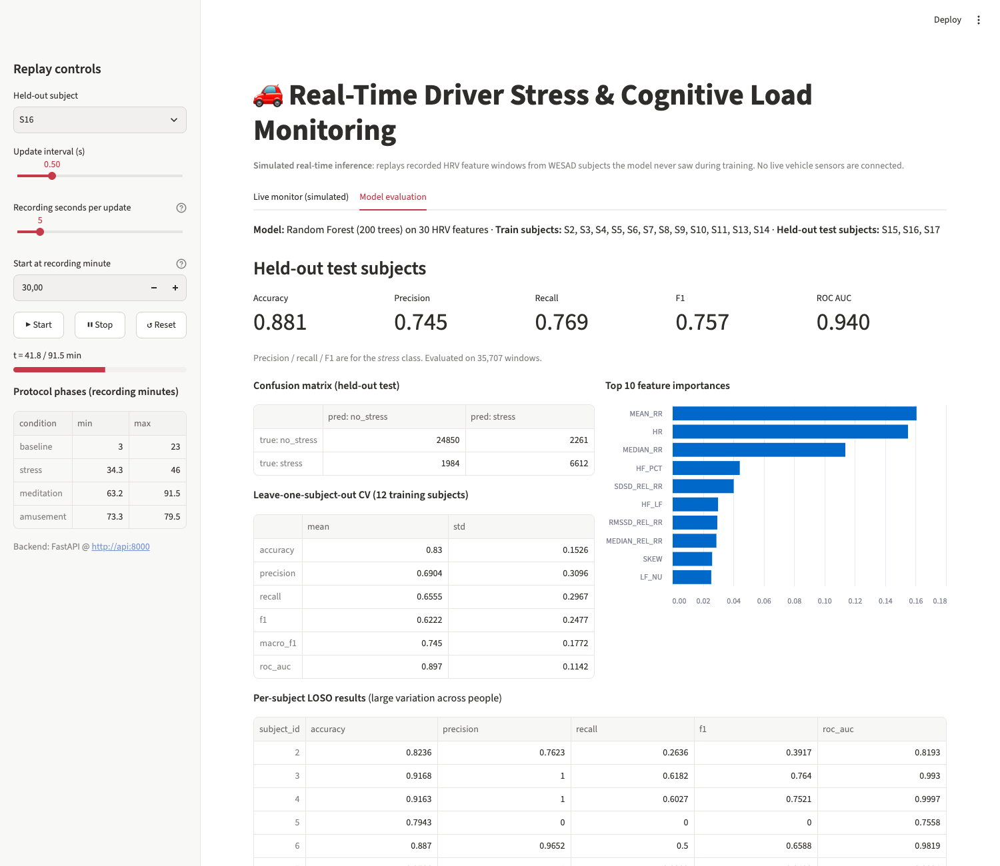
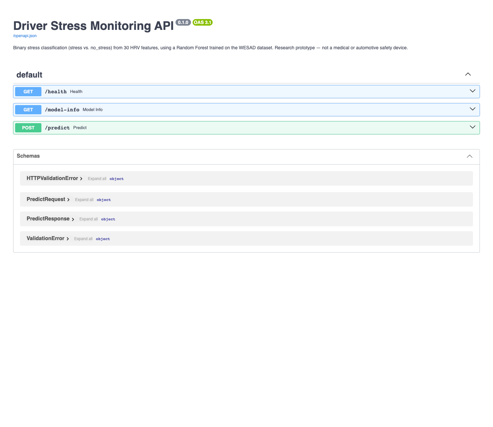

# Real-Time Driver Stress & Cognitive Load Monitoring

[](https://github.com/Rakibul-cyber/driver-stress-monitoring/actions/workflows/ci.yml)

An end-to-end machine learning MVP that classifies **physiological stress vs. no stress** from heart-rate-variability (HRV) features and serves predictions through a **FastAPI** service and a **Streamlit** monitoring dashboard, with **simulated real-time** replay of held-out recordings. Everything runs in Docker.

> **Scope note.** The dashboard *replays recorded* WESAD data from subjects the model never saw during training. It simulates a streaming pipeline and is **not** connected to live vehicle sensors. WESAD was recorded in a lab (stress induced with the Trier Social Stress Test), not while people were driving.



| Model evaluation tab | API docs (OpenAPI) |
|---|---|
|  |  |

## Architecture

```
WESAD HRV CSV ──► preprocessing.py ──► train.py ──► models/stress_rf.joblib (imputer + RF pipeline)
                  (schema check,        (LOSO CV,     models/model_metadata.json (features, metrics)
                   dedup, labels)        held-out      data/processed/holdout.parquet (replay data)
                                         test)
                                              │
                              inference.py (StressPredictor, replay generator)
                                 │                         │
                           api.py (FastAPI)  ◄── HTTP ──  app.py (Streamlit dashboard)
```

## Dataset

| | |
|---|---|
| Source used | [`GeorgiaCh96/WESAD_raw_data`](https://huggingface.co/datasets/GeorgiaCh96/WESAD_raw_data) on Hugging Face: one CSV of HRV features computed from WESAD |
| Original dataset | [WESAD](https://ubi29.informatik.uni-siegen.de/usi/data_wesad.html), Univ. Siegen / Bosch |
| Size | 196,978 rows × 66 columns; **184,276 rows after removing exact duplicates** (subject S10's recording appears twice in the CSV) |
| Subjects | 15 (S2–S11, S13–S17, matching the original WESAD subject IDs) |
| Labels (`condition`) | baseline 76,440 · meditation 51,976 · stress 43,886 · amusement 24,676 (raw counts) |
| Binary target | `stress` = 1; baseline / amusement / meditation = 0 (22% stress after dedup) |
| Missing values | none (no NaN or inf); a median imputer is still part of the pipeline for robustness |
| Window spacing | sliding HRV windows emitted every 0.25 s (heavily overlapping) |

**Feature selection.** The CSV holds 62 features: 32 base HRV features (time-domain: `MEAN_RR`, `RMSSD`, `SDRR`, `HR`, `pNN50`, …; frequency-domain: `VLF`, `LF`, `HF`, `LF_HF`, …), plus log/sqrt/Box-Cox/Yeo-Johnson transforms of those. The model uses the **30 unique base features** (see `FEATURES` in [src/preprocessing.py](src/preprocessing.py)). Excluded columns:
- the monotonic transforms, which are redundant for tree models;
- `KURT_REL_RR` and `SKEW_REL_RR`, which are identical to `KURT` and `SKEW` in this file;
- `Time`, which encodes protocol order and would leak the condition;
- `SSSQ`, a self-reported stress questionnaire score and therefore label leakage.

**License / attribution.** WESAD may be used for *scientific, non-commercial purposes* provided credit is given to the owners. The data is **not** committed to this repository; it is downloaded by script. Please cite:

> Philip Schmidt, Attila Reiss, Robert Duerichen, Claus Marberger and Kristof Van Laerhoven. *Introducing WESAD, a multimodal dataset for Wearable Stress and Affect Detection.* ICMI 2018, Boulder, USA. https://doi.org/10.1145/3242969.3242985

The Hugging Face derivative has no license file. The HRV feature extraction was done by its uploader and has not been independently verified here.

## Method

- **Model:** scikit-learn `Pipeline(SimpleImputer(median) → RandomForestClassifier(200 trees, max_depth=20, min_samples_leaf=5, class_weight="balanced"))`, saved as one joblib file. Training and inference therefore always use identical preprocessing.
- **Subject-independent evaluation (no leakage):**
  1. Subjects **S15, S16, S17 are held out entirely**. They serve as the final test set and as the replay data for the dashboard.
  2. **Leave-one-subject-out (LOSO) cross-validation** runs on the remaining 12 subjects.
  3. The final model is trained on all 12 training subjects and scored once on the held-out 3.
- Training rows are subsampled to 1 Hz (every 4th overlapping window) to reduce redundancy; the test set is scored on all 35,707 windows.
- Decision threshold 0.5. Precision, recall and F1 are reported for the *stress* class.

## Results

These are the actual outputs of `python -m src.train`, also stored in [models/model_metadata.json](models/model_metadata.json) and [reports/train_log.txt](reports/train_log.txt).

**Held-out test subjects (S15, S16, S17; 35,707 windows)**

| Accuracy | Precision | Recall | F1 (stress) | Macro-F1 | ROC-AUC |
|---|---|---|---|---|---|
| 0.881 | 0.745 | 0.769 | 0.757 | 0.839 | 0.940 |

Confusion matrix (rows = true, columns = predicted):

| | pred no_stress | pred stress |
|---|---|---|
| **true no_stress** | 24,850 | 2,261 |
| **true stress** | 1,984 | 6,612 |

**LOSO CV on 12 training subjects (mean ± std across subjects)**

| Accuracy | Precision | Recall | F1 (stress) | Macro-F1 | ROC-AUC |
|---|---|---|---|---|---|
| 0.830 ± 0.153 | 0.690 ± 0.310 | 0.655 ± 0.297 | 0.622 ± 0.248 | 0.745 ± 0.177 | 0.897 ± 0.114 |

Performance varies widely between people. For example, S7 reaches F1 0.94, while for S5 the model detects none of the stress windows (F1 0.00), and S10 has accuracy 0.36. The held-out score of 0.881 comes from just 3 subjects; read the LOSO numbers as the more realistic estimate.

**Inference latency:** roughly 5–10 ms per single-window prediction in-process on an Apple-silicon Mac (measured by the replay CLI), slightly higher through the API.

**Reproducibility.** Training uses a fixed seed and pinned library versions.

- **Same platform:** a fresh clone reproduces the exact numbers above on macOS (arm64, Python 3.13).
- **Linux / Python 3.12 (Docker and CI):** the same code gives metrics within about 0.005 of the numbers above. For example, held-out accuracy is 0.883 and F1 0.762, caused by platform-specific floating-point differences in the Random Forest.

## Quick start (local)

Requires Python 3.11+ (developed with 3.13; the Docker image uses 3.12).

```bash
python3 -m venv .venv && source .venv/bin/activate
pip install -r requirements.txt

python -m src.download_data     # ~225 MB CSV -> data/raw/
python -m src.train             # ~30 s: LOSO CV, held-out test, saves model + holdout replay data
pytest -q                       # 10 tests
```

### Simulated real-time replay (CLI)

```bash
python -m src.inference --subject 16 --start 4000 --interval 0.5 --limit 30
```

Each output line shows one replayed window: the prediction, its confidence, the ground-truth condition and the inference latency.

### API

```bash
uvicorn src.api:app --port 8000
# Swagger UI: http://localhost:8000/docs  ("Try it out" on /predict is pre-filled with a real example)
```

| Endpoint | Description |
|---|---|
| `GET /health` | Service and model status |
| `GET /model-info` | Feature list, label names, split, CV and test metrics, feature importances, example input |
| `POST /predict` | Body `{"features": {<all 30 HRV features>}}` → label, probabilities, confidence, latency |

```bash
curl -s localhost:8000/model-info | python -c 'import sys,json; print(json.dumps({"features": json.load(sys.stdin)["example_input"]}))' > example.json
curl -s -X POST localhost:8000/predict -H 'content-type: application/json' -d @example.json
# {"label":"no_stress","label_id":0,"probabilities":{"no_stress":0.9171,"stress":0.0829},"confidence":0.9171,"latency_ms":...}
```

Missing or unknown features, non-numeric values and NaN/inf return **HTTP 422** with a message that names the problem fields. If the model file is missing, the API returns **503**.

### Dashboard

```bash
streamlit run app.py                                  # loads the model in-process
API_URL=http://localhost:8000 streamlit run app.py    # or calls the FastAPI service
```

Pick a held-out subject and click **Start**. Use *Start at recording minute* to jump straight to a phase; the sidebar lists each subject's protocol phase times (e.g. S16 stress: 34.3–46.0 min). *Recording seconds per update* fast-forwards the replay.

## Docker

Train once locally first (above): the image packages `models/` and `data/processed/holdout.parquet`.

```bash
docker compose up --build
# API:       http://localhost:8000/docs
# Dashboard: http://localhost:8501   (calls the API container via API_URL)
docker compose exec api pytest -q     # tests inside the container (raw-CSV test is skipped there)
docker compose down
```

Compose is used only because two processes (API and dashboard) run from the same image.

## Continuous integration

[.github/workflows/ci.yml](.github/workflows/ci.yml) runs on every push to `main`, on pull requests and on manual dispatch, using Ubuntu and Python 3.12. It:

1. installs the pinned requirements;
2. downloads the dataset (cached between runs);
3. trains and evaluates the model;
4. runs `pytest`;
5. builds the Docker image;
6. smoke-tests the API container (`/health`, `/model-info`, `/predict`).

The dataset is downloaded at CI time and is never stored in the repository.

## Project structure

```
├── app.py                   Streamlit dashboard
├── src/
│   ├── preprocessing.py     paths, feature list, schema validation, cleaning, input validation
│   ├── download_data.py     dataset download
│   ├── train.py             LOSO CV, held-out evaluation, artifact export
│   ├── inference.py         StressPredictor + simulated replay (CLI)
│   └── api.py               FastAPI service
├── tests/test_pipeline.py   schema, model output, replay, API endpoints
├── models/                  model_metadata.json (committed), stress_rf.joblib (generated)
├── data/                    raw/ and processed/ (generated, git-ignored)
├── reports/train_log.txt    training run output
├── docs/                    screenshots
├── .github/workflows/ci.yml train → test → Docker build → API smoke test
├── Dockerfile, docker-compose.yml, requirements.txt
```

## Known limitations

- **Lab data, not driving data.** WESAD stress is induced by public speaking and mental arithmetic while seated. Driving stress, cognitive load and in-vehicle signal quality (motion artefacts, steering-wheel or seat sensors) differ substantially. The title describes the target application; this MVP does not validate it.
- **"Cognitive load" is not modelled.** The only labels are stress, baseline, amusement and meditation.
- **Small cohort.** 15 subjects (12 for training, 3 for testing). Per-subject performance varies strongly, and some subjects' stress is not detected at all.
- **No per-driver calibration.** Raw HRV features differ a lot between individuals. Normalising each person's features against their own baseline is a known way to improve cross-subject results and is the most promising next step.
- **Pre-computed features.** The model consumes HRV features from the Hugging Face derivative, not raw ECG or BVP signals. The feature extraction pipeline is not part of this repo, so a true live system would also need a signal-to-feature stage.
- Heavily overlapping windows: adjacent predictions are strongly correlated, and window-level metrics overstate the number of independent observations.
- The threshold is fixed at 0.5; it was not tuned for a particular precision/recall trade-off.
- Research prototype; not a medical or safety-certified system.

## Possible next steps

Subject-baseline normalisation · a raw-signal (ECG/EDA) feature pipeline on the original WESAD files · temporal smoothing of predictions · gradient-boosting comparison and threshold tuning · validation on driving datasets (e.g. the PhysioNet *Stress Recognition in Automobile Drivers* database).
